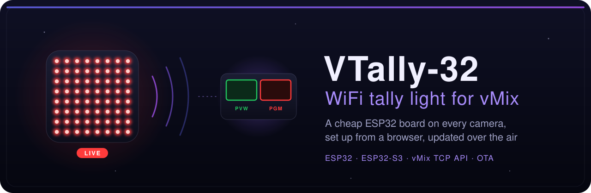
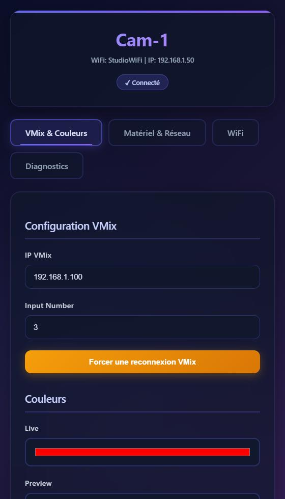

<div align="center">



<h3>One ESP32 per camera: red when you're live, green when you're next.</h3>

<p>
  <a href="https://github.com/lfpoulain/VTally-32/releases/latest"></a>
  <a href="https://github.com/lfpoulain/VTally-32/actions/workflows/firmware-release.yml"></a>
  
  
  
  <a href="LICENSE"></a>
</p>

<p>
  <a href="#-get-started">Get started</a> ·
  <a href="#-what-it-does">What it does</a> ·
  <a href="#️-the-web-interface">Web interface</a> ·
  <a href="#-updating">Updating</a> ·
  <a href="#️-build-from-source">Build</a> ·
  <a href="#-http-api">API</a> ·
  <a href="#-license">License</a>
</p>

</div>

---

VTally-32 turns a cheap ESP32 board and a few WS2812B LEDs into a WiFi tally light for [vMix](https://www.vmix.com/). Each tally watches one vMix input and lights up **red** when it is on air, **green** when it is in preview. Everything is set from a browser: no recompiling, no USB cable after the first flash.

It talks to vMix over the official **TCP API** (port `8099`, `SUBSCRIBE TALLY`): vMix pushes every change the instant it happens, so the light follows your cuts without polling.

## 🧰 What you need

| | |
|---|---|
| 🧠 **A board** | any **ESP32** or **ESP32-S3**. The [Waveshare ESP32-S3-Matrix](https://www.waveshare.com/wiki/ESP32-S3-Matrix) works out of the box: its 8x8 LED matrix is already on GPIO 14 |
| 💡 **LEDs** | a WS2812B / NeoPixel LED, strip or 8x8 matrix, if your board has none |
| 🎬 **vMix** | on the same local network, with the TCP API on port `8099` (on by default) |
| 📶 **WiFi** | 2.4 GHz. A strong signal matters more than anything else: aim for better than -70 dBm (see the **Diagnostics** tab) |

Wiring for a bare board, with the default pin:

```text
ESP32 / ESP32-S3      WS2812B
GPIO 14        ---->  DIN
5V             ---->  VCC
GND            ---->  GND
```

> [!TIP]
> Beyond about ten LEDs, power them from a separate 5 V supply. On the 8x8 matrix, keep the brightness low: 64 LEDs at full power heat the board for no visible gain in a studio.

## 🚀 Get started

1. **Flash the board once.** Download `vtally-32-esp32-merged.bin` or `vtally-32-esp32s3-merged.bin` from the [latest release](https://github.com/lfpoulain/VTally-32/releases/latest) and write it at address `0x0`, either from Chrome with the [ESP web flasher](https://espressif.github.io/esptool-js/) or with esptool:

   ```sh
   esptool.py --chip esp32s3 write_flash 0x0 vtally-32-esp32s3-merged.bin
   ```

2. **Join its access point.** The tally opens a WiFi network named **`VTally-32`**, password **`vtally32`**. Open `http://192.168.4.1`.
3. **Give it your WiFi.** In the **WiFi** tab, scan, pick your network, type the password, save. The tally restarts, joins your network and closes its access point.
4. **Point it at vMix.** Reach it at `http://vtally-32.local` (or its IP). In the **VMix & Couleurs** tab, enter the vMix PC address and the input number to watch. The badge turns to **✓ Connecté**.

> [!NOTE]
> Rename each tally (`Cam-1`, `Cam-2`…) in **Matériel & Réseau**: the name becomes its access point, its hostname and its mDNS address (`http://cam-1.local`).

## ✨ What it does

<table>
  <tr>
    <td width="50%" valign="top">
      <h4>⚡ Follows your cuts instantly</h4>
      vMix pushes each tally change over TCP the moment it happens. The tally handles it before anything else in its loop, with WiFi power saving turned off to avoid 100 to 300 ms of radio wake-up delay.
    </td>
    <td width="50%" valign="top">
      <h4>🫀 Never shows a stale state</h4>
      Every second the tally asks vMix for the full tally state. If vMix stays silent for 4 seconds, the tally turns off and reconnects, instead of staying red on a dead connection.
    </td>
  </tr>
  <tr>
    <td valign="top">
      <h4>📶 Rides out WiFi glitches</h4>
      A short drop is left to the WiFi driver, without tearing down the vMix link. The tally retries every 10 seconds, and only reopens its own access point after 30 seconds without WiFi, so you can still reach it.
    </td>
    <td valign="top">
      <h4>🎨 Yours to tune</h4>
      Live, preview and off colors, brightness, LED pin and count, single LED or 8x8 matrix: all from the browser, stored in flash and kept across reboots.
    </td>
  </tr>
  <tr>
    <td valign="top">
      <h4>🩺 Tells you what's wrong</h4>
      A <b>Diagnostics</b> tab shows signal strength, memory, uptime and the vMix link. On the 8x8 matrix, <b>Live debug</b> shows a digit for each step of the startup.
    </td>
    <td valign="top">
      <h4>🔄 Updates over the air</h4>
      Upload a new firmware from the web page, or push it to every tally at once with one <code>curl</code> per device.
    </td>
  </tr>
</table>

## 🖥️ The web interface



The interface is in French. Its header shows the tally's name, network and live state: **⚠ Déconnecté**, **✓ Connecté**, **🟢 PREVIEW** or **🔴 LIVE**.

| Tab | What you set |
|---|---|
| **VMix & Couleurs** | vMix IP, input number, live / preview / off colors, brightness, forced reconnection |
| **Matériel & Réseau** | tally name, LED pin, LED count, display mode (`Tally simple` or `Écran 8x8`), live debug, serial log level |
| **WiFi** | network scan, SSID and password, reboot, firmware update |
| **Diagnostics** | firmware version, uptime, memory, WiFi mode and signal, vMix link, tally state, LED settings |

Changes to colors and vMix apply at once; the name, hardware and WiFi settings restart the tally.

<br clear="right" />

### 🔢 Live debug codes (8x8 matrix)

With **Écran 8x8** and **Live debug** on, the matrix shows a digit while the tally is neither live nor in preview:

| Digit | Meaning |
|---|---|
| `1` | joining WiFi |
| `2` | connecting to vMix |
| `3` | connected to vMix (the matrix shows the off color) |
| `4` / `5` | preview / live (the matrix shows the tally color) |
| `6` | vMix unreachable or connection lost |
| `7` | access point only, no WiFi configured |
| `8` | WiFi ready |
| `9` | WiFi failed, access point reopened |

## 🔄 Updating

Each push to `main` that bumps `FIRMWARE_VERSION` builds both boards and publishes a [GitHub release](https://github.com/lfpoulain/VTally-32/releases). Use the file ending in **`-ota.bin`** that matches your board.

**From the browser:** **WiFi** tab → **Firmware `.bin`** → **Installer le firmware**. The tally restarts on the new version within seconds.

**From a terminal**, for a whole set of tallies:

```sh
for ip in 192.168.1.50 192.168.1.51 192.168.1.52; do
  curl -F "firmware=@vtally-32-esp32s3-ota.bin" http://$ip/update
done
```

> [!IMPORTANT]
> Never upload the `bootloader`, `partitions` or `merged` files over the air: they are for the first USB flash only. A firmware built for the other chip is rejected when the update is finalized, and the tally keeps its current version.

## 🛠️ Build from source

With [arduino-cli](https://arduino.github.io/arduino-cli/) and the ESP32 core 3.x:

```sh
arduino-cli config add board_manager.additional_urls https://raw.githubusercontent.com/espressif/arduino-esp32/gh-pages/package_esp32_index.json
arduino-cli core update-index
arduino-cli core install esp32:esp32
arduino-cli lib install "ArduinoJson" "Adafruit NeoPixel"

arduino-cli compile --fqbn esp32:esp32:esp32 vmix_tally_esp32
arduino-cli compile --fqbn "esp32:esp32:esp32s3:CDCOnBoot=cdc,USBMode=hwcdc" vmix_tally_esp32
```

On the ESP32-S3, `CDCOnBoot=cdc` keeps the serial log on the native USB port, as in the release builds.

On Windows, `upload-esp32.ps1` compiles and flashes in one go. It waits for the board to be plugged in, finds its COM port and switches to the right chip on its own:

```powershell
powershell -ExecutionPolicy Bypass -File .\upload-esp32.ps1
powershell -ExecutionPolicy Bypass -File .\upload-esp32.ps1 -Port COM3 -Fqbn esp32:esp32:esp32s3
```

The serial log (115200 baud) has four levels, set in **Matériel & Réseau**: `None`, `Errors`, `Normal` (default) and `Debug`, which prints every line received from vMix.

## 🔌 HTTP API

The web interface is built on a small JSON API, handy for scripts and monitoring.

| Endpoint | Method | Purpose |
|---|---|---|
| `/status` | `GET` | tally state: `connected`, `live`, `preview`, vMix target, WiFi |
| `/diagnostics` | `GET` | everything in the **Diagnostics** tab, including `firmware_version` and `wifi_rssi` |
| `/config` | `GET` / `POST` | read or change the settings (JSON) |
| `/scan` | `GET` | WiFi networks around the tally |
| `/wifi` | `POST` | save SSID and password, then restart |
| `/vmix/reconnect` | `POST` | drop and reopen the vMix connection |
| `/update` | `POST` | install a firmware (`multipart/form-data`, file ending in `.bin`) |
| `/reboot` | `POST` | restart the tally |

```sh
curl http://cam-1.local/status
# {"connected":true,"live":false,"preview":true,"vmix_host":"192.168.1.100","vmix_input":"3","wifi_ssid":"StudioWiFi","wifi_ip":"192.168.1.50"}
```

## 🗂️ Layout

| File | Role |
|---|---|
| `vmix_tally_esp32/vmix_tally_esp32.ino` | constants, globals, `setup()` and `loop()`, `FIRMWARE_VERSION` |
| `vmix_tally_esp32/vmix.ino` | vMix TCP link: subscription, heartbeat, watchdog, reconnection, tally parsing |
| `vmix_tally_esp32/wifi.ino` | WiFi station, access point, mDNS, recovery after a drop |
| `vmix_tally_esp32/led.ino` | LED colors, 8x8 matrix and debug digits |
| `vmix_tally_esp32/config.ino` | settings: validation, load and save in flash |
| `vmix_tally_esp32/web.ino` | web page and HTTP handlers, OTA upload |
| `vmix_tally_esp32/diagnostics.ino` | `/diagnostics` |
| `upload-esp32.ps1` | compile and flash over USB on Windows |
| `.github/workflows/firmware-release.yml` | build for both chips, release when the version changes |

## 🧪 Tried on hardware

On 29 October 2026, three Waveshare ESP32-S3-Matrix tallies on a studio network with vMix: over-the-air update of all three, vMix connection and heartbeat kept for over an hour, recovery after an access point change without a reboot.

A weak WiFi signal was the main cause of a flaky tally: one unit at -81 dBm misbehaved, and the same unit at -44 dBm next to an access point was solid.

## ⚠️ Known limits

- The web interface and its API have **no password**: keep the tallies on a trusted production network.
- One input per tally. Overlays and multiple inputs on one light are not supported.

Version history is in [CHANGELOG.md](CHANGELOG.md).

## 📜 License

VTally-32 is distributed under the [VTally-32 Non-Commercial Attribution License 1.0](LICENSE): free to use, modify and share for non-commercial purposes, crediting **LFPoulain** as the original author and marking modified versions as such. Commercial use requires written permission.

The Arduino core and libraries it is built with keep their own licenses: see [THIRD_PARTY_NOTICES.md](THIRD_PARTY_NOTICES.md).
